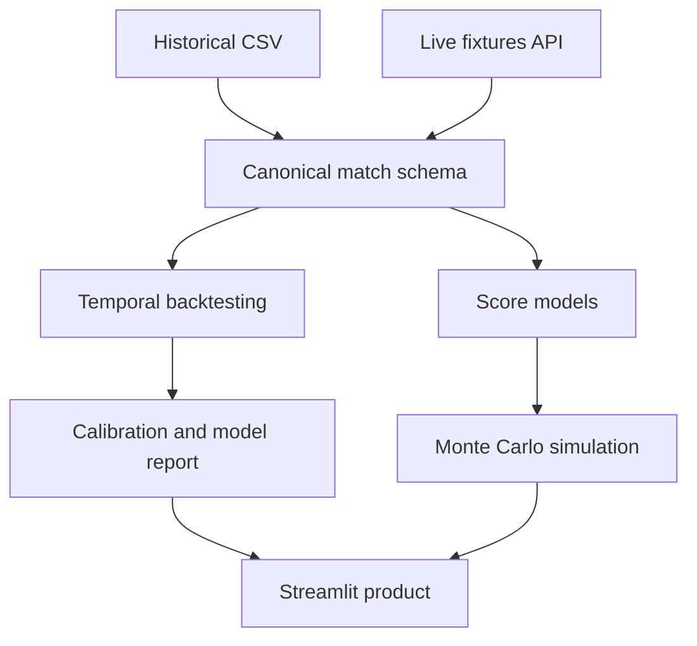

# Football Forecasting & Simulation Lab

An end-to-end football intelligence product for calibrated score forecasting,
leak-free backtesting, and Monte Carlo league simulations.

The initial scope covers the English Premier League and Spanish La Liga. The
architecture separates historical training data from current competition state,
so new providers and leagues can be added without rewriting the models.

> **Current status:** the engineering MVP is verified with deterministic
> synthetic data. Real Premier League and La Liga results must be generated with
> the documented commands before making performance claims.

## Product questions

- What are the probabilities of a home win, draw, and away win?
- Which exact scorelines are most likely, and with what uncertainty?
- Are the forecasts calibrated when evaluated strictly through time?
- Does a model beat league-rate, independent Poisson, and market baselines?
- How often does each team finish first, top four, or in the relegation zone?
- How sensitive is the final table to the remaining fixture schedule?

## Why this is more than a prediction notebook

The repository includes four reviewable layers:

1. provider adapters and one canonical match contract;
2. probabilistic statistical models with time decay;
3. expanding-window evaluation with a temporal-leakage assertion;
4. an interactive Streamlit product for forecasts and simulations.

It also includes unit tests, generated model reports, Docker, CI, a model card,
data-source governance, and command-line workflows for real data.

## Verified synthetic demo

The deterministic demo makes 170 strictly future predictions per model. Lower
is better for all three proper scoring rules.

| Model | Log loss | Brier score | Ranked probability score | Accuracy |
|---|---:|---:|---:|---:|
| Dixon–Coles | 1.0491 | 0.6283 | 0.2274 | 0.4706 |
| Independent Poisson | 1.0532 | 0.6290 | 0.2276 | 0.4765 |
| League-rate baseline | 1.0790 | 0.6541 | 0.2373 | 0.3765 |

These values validate the software and experimental design. They are not EPL
or La Liga benchmark results.

## Data strategy

| Source | Project role | Access | Status |
|---|---|---|---|
| [Football-Data.co.uk](https://www.football-data.co.uk/data.php) | Historical results, stats, and odds | Free CSV, no key | Adapter implemented |
| [football-data.org v4](https://www.football-data.org/documentation/quickstart) | Current results and fixtures | Free EPL/La Liga token | Adapter implemented |
| [OpenFootball](https://openfootball.github.io/) | CC0 results fallback | Public domain | Adapter planned |
| [StatsBomb Open Data](https://github.com/hudl/open-data) | Event-level tactical analytics | Selected open data | Module planned |

The project does not redistribute provider datasets. See
[`docs/data_sources.md`](docs/data_sources.md) before publishing a deployment.

## Quick start

Python 3.11+ is recommended.

```bash
python -m venv .venv
source .venv/bin/activate
pip install -e .

football-lab demo --output-dir reports/generated --simulations 2000
python -m unittest discover -s tests -v
```

Generated artifacts include:

- model benchmark metrics;
- calibration reliability table;
- team-strength estimates;
- league and position probabilities;
- a decision-oriented model report.

## Explore everything in Jupyter

Install the notebook tools and launch Jupyter from the repository root:

```bash
pip install -e ".[notebook]"
python -m ipykernel install --user --name football-lab --display-name "Football Lab"
jupyter lab
```

Open [`notebooks/01_end_to_end_forecasting_lab.ipynb`](notebooks/01_end_to_end_forecasting_lab.ipynb)
and select the **Football Lab** kernel. The notebook runs the synthetic benchmark,
visualizes score probabilities, and executes a league simulation. Its real-data
section is disabled by default and can be enabled with one variable.

## Fetch real historical data

Football-Data.co.uk requires no API key:

```bash
football-lab fetch-historical \
  --leagues premier_league la_liga \
  --seasons 2021-22 2022-23 2023-24 2024-25 2025-26 \
  --canonical-output data/matches.csv
```

Run identical per-league walk-forward benchmarks:

```bash
football-lab backtest \
  --input data/matches.csv \
  --initial-train-matches 760 \
  --refit-every 100 \
  --output-dir reports/real_data
```

When odds are present, the report automatically adds normalized market
consensus as a difficult benchmark. A model should not be presented as strong
merely because it beats a uniform or accuracy baseline.

## Fetch current fixtures

Register for a free football-data.org token, keep it outside Git, and run:

```bash
export FOOTBALL_DATA_API_TOKEN="your-token"

football-lab fetch-fixtures \
  --league premier_league \
  --season 2026 \
  --output data/premier_league_fixtures.csv
```

The API uses competition code `PL` for Premier League and `PD` for La Liga.

## Simulate a real season

```bash
football-lab simulate \
  --history data/matches.csv \
  --fixtures data/premier_league_fixtures.csv \
  --league premier_league \
  --season 2026 \
  --simulations 10000 \
  --output reports/real_data/premier_league_simulation.csv
```

The model trains on all earlier completed matches, while the table state uses
only completed matches from the simulated season.

## Run the dashboard

```bash
pip install -e ".[dashboard]"
streamlit run streamlit_app.py
```

The dashboard opens in an explicitly labeled synthetic mode and also accepts a
Football-Data.co.uk season CSV upload.

## Architecture



See [`docs/architecture.md`](docs/architecture.md) for boundaries and design
decisions.

## Repository map

```text
src/football_lab/
├── data/            # canonical schema and provider adapters
├── models/          # baselines, Poisson, and Dixon-Coles
├── evaluation/      # proper scoring rules and walk-forward testing
├── simulation/      # standings and Monte Carlo finish probabilities
├── pipeline.py      # reproducible reports
└── cli.py           # operational workflows
```

## Methodology guardrails

- Every backtest prediction uses only observations strictly before its date.
- Premier League and La Liga are modeled and evaluated separately.
- Accuracy is secondary to log loss, Brier score, RPS, and calibration.
- Market odds are margin-normalized before comparison.
- Synthetic, historical-backtest, and live forecasts remain clearly separated.
- Predictions express uncertainty; they are not betting advice.

## Roadmap

- [ ] Publish multi-season EPL and La Liga benchmark results.
- [ ] Add the CC0 OpenFootball fallback adapter.
- [ ] Add bootstrap confidence intervals for paired log-loss differences.
- [ ] Add Elo and hierarchical Bayesian benchmarks.
- [ ] Add rolling injuries, rest, and promoted-team priors where lawful data exists.
- [ ] Schedule daily ingestion and prediction snapshots.
- [ ] Add prediction-drift and calibration monitoring.
- [ ] Add a StatsBomb xG/xT tactical-analysis module.
- [ ] Deploy the Streamlit dashboard with visible source attribution.

## License

Project code is MIT licensed. Third-party data remains subject to each
provider's separate terms and attribution requirements.
